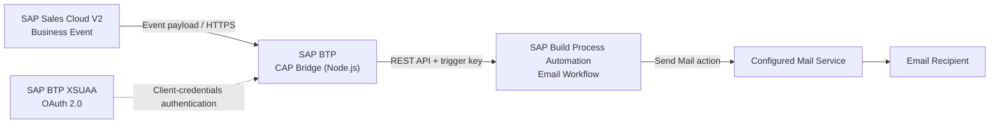

# SAP Sales Cloud V2 Event-Driven Email Automation

> **Integrating SAP Sales Cloud V2, SAP BTP CAP (Node.js), and SAP Build Process Automation to automate business email notifications.**


## Overview

This project demonstrates an event-driven integration pattern for SAP CX: an event from **SAP Sales Cloud V2** is delivered to a custom **CAP bridge service on SAP BTP**, which invokes a **SAP Build Process Automation (BPA)** process. The process then sends an email through a configured mail service.

The CAP bridge acts as a lightweight integration layer between the business event source and the automation workflow.

## High-Level Architecture



### Runtime flow

1. **Business event:** An event notification is configured in Sales Cloud V2, for example for an Opportunity Created or Updated event.
2. **Receive event:** Sales Cloud sends the event payload to the CAP bridge endpoint.
3. **Invoke automation:** The CAP service handles the incoming request and calls the deployed BPA trigger endpoint.
4. **Run workflow:** BPA starts the configured automation process and executes its Send Mail action.
5. **Deliver email:** The configured mail service delivers the message to the intended recipient.

> The exact event types, endpoint paths, payload fields, and authentication requirements depend on the tenant and deployed configuration.

## Solution Components

| Component | Responsibility |
|---|---|
| SAP Sales Cloud V2 | Produces business event notifications |
| SAP BTP, Cloud Foundry environment | Hosts the CAP bridge application and supporting service instances |
| CAP with Node.js | Exposes an API endpoint and forwards event payloads to BPA |
| SAP Build Process Automation | Orchestrates the email notification workflow |
| SAP BTP XSUAA | Supports OAuth 2.0 client-credentials authentication for the CAP application |
| Configured mail service/destination | Supports outbound email delivery |

## Technology Stack

- **SAP Sales Cloud V2**
- **SAP Business Technology Platform (SAP BTP)**
- **SAP Cloud Application Programming Model (CAP)**
- **Node.js**
- **SAP Build Process Automation**
- **OAuth 2.0 Client Credentials**
- **SAP Authorization and Trust Management service (XSUAA)**
- **REST APIs / HTTP**
- **Postman** for endpoint testing

## Project Structure

The service files recorded for this implementation are:

```text
.
├── srv/
│   ├── bridge-service.cds   # CAP service definition
│   └── bridge-service.js    # Service implementation and integration logic
├── package.json
├── manifest.yaml            # Cloud Foundry deployment configuration (if used)
├── xs-security.json         # XSUAA security descriptor (if used)
├── .env                     # Local configuration; do not commit
├── .gitignore
└── docs/
    └── architecture.png     # High-level architecture diagram
```

> Adjust this tree to match the actual repository. Include only files that exist in your project.

## Configuration

The application needs tenant- and environment-specific configuration for the BPA trigger and authentication. The implementation notes identify the following variable names; confirm the names used by your current code before deployment.

| Variable | Purpose |
|---|---|
| `BPA_API_KEY` | API key used to invoke the BPA trigger, if required by the configured trigger |
| `BPA_TOKEN_URL` | OAuth token endpoint for the relevant service/authentication flow |
| `BPA_CLIENT_ID` | OAuth client ID |
| `BPA_CLIENT_SECRET` | OAuth client secret |
| `BPA_DESTINATION_ID` | Destination identifier, if consumed by the application |

Use the actual trigger URL and other required endpoint settings from your SAP BTP / SAP Build configuration. If the code uses an additional variable for the trigger URL, document it here using the exact name from the source.

### Security notes

- **Never commit** `.env`, service keys, client secrets, API keys, access tokens, or real customer payloads.
- Store secrets in the deployment environment or supported service bindings.
- Use separate credentials for separate authentication flows; do not assume Sales Cloud-to-CAP credentials and CAP-to-BPA trigger credentials are interchangeable.
- Redact tenant URLs and identifiers in public examples where necessary.

## Setup and Deployment

The following is a high-level outline. Use the commands and configuration appropriate to your repository and Cloud Foundry target.

### 1. Install dependencies

```bash
npm install
```

### 2. Run locally

If the project is configured for standard CAP development:

```bash
cds watch
```

Check the terminal output for the actual service URL and endpoint. Local execution may require environment variables or a local `.env` file.

### 3. Configure SAP BTP services

1. Create or identify the required XSUAA service instance.
2. Bind the required service instance to the CAP application.
3. Create the required service key(s) and securely retrieve the necessary credentials.
4. Configure the application environment variables using the exact names expected by the code.
5. Confirm the BPA trigger endpoint, API key requirements, and mail-service configuration.

### 4. Deploy to Cloud Foundry

Deploy using the deployment method and manifest appropriate to the project. For example, a Cloud Foundry push may be used when the project has a valid `manifest.yaml` and the required environment is targeted.

```bash
cf target
cf push
```

> These are illustrative commands, not a guaranteed deployment sequence. Follow the project's actual deployment configuration, and verify the deployed application, bindings, and environment variables before testing.

## Configure SAP Sales Cloud V2

In Sales Cloud V2, configure the outbound communication system and event notification according to your tenant setup:

1. Create or select the outbound communication system.
2. Configure the CAP application's host and the required OAuth 2.0 client-credentials settings.
3. Save and activate the communication system.
4. Create an event notification rule for the required business entity and event type.
5. Select the communication system and configure the subscription path to match the CAP endpoint.
6. Save and activate the rule, then test with a suitable business event.

The endpoint path noted during implementation was:

```text
/bridge/receiveOpportunityEvent
```

**Verify this path against the current CAP service implementation before using it.** A path mismatch will prevent the event from reaching the intended handler.

## Configure SAP Build Process Automation

1. Create an automation process.
2. Add and configure the process trigger.
3. Add the Send Mail action and configure the required message details.
4. Configure the required mail service/destination in the relevant BTP environment.
5. Save, release, and deploy the process to the intended environment.
6. Retrieve the deployed trigger details and configure the CAP bridge to call the correct endpoint.

The exact trigger authentication and mail destination properties must be verified against the deployed BPA process and tenant configuration.

## Testing

Test each integration boundary separately before performing an end-to-end test.

### 1. Test the CAP endpoint

Send a representative event payload to the CAP endpoint in a development environment. Confirm that the request is accepted, handled, and logged as expected.

### 2. Test the BPA trigger

Use Postman to call the deployed trigger endpoint with the authentication and headers required by the configured trigger. Use a synthetic payload that matches the process's expected schema.

### 3. Test the end-to-end flow

- Trigger a test event in Sales Cloud V2.
- Confirm that the CAP application receives the event.
- Confirm that the CAP bridge successfully invokes BPA.
- Confirm that the BPA process completes.
- Confirm receipt of the email by the intended test recipient.
- Review application and process logs if any stage fails.

### Acceptance checklist

- [ ] Sales Cloud communication system is active.
- [ ] Event notification rule is active and targets the correct endpoint.
- [ ] CAP application is deployed and reachable.
- [ ] Required credentials and service bindings are configured securely.
- [ ] CAP successfully invokes the BPA trigger.
- [ ] BPA process completes without errors.
- [ ] Test email is received.

## Design Considerations and Future Improvements

Potential enhancements for a more robust implementation include:

- Structured logging with correlation IDs across Sales Cloud, CAP, and BPA.
- Input validation and clear error responses for malformed event payloads.
- Retry strategy and handling for temporary downstream failures.
- Idempotency or duplicate-event protection.
- Monitoring and alerting for failed workflow executions.
- Automated tests for the CAP service and payload mapping.
- Separate configuration for development, test, and production environments.

These are suggested enhancements; list them as implemented only after they have been added and tested.

## Current Status

This repository documents a personal learning and implementation project. Update this section to reflect the verified state of your build:

- **Implemented:** [list the parts completed and tested]
- **Validated end to end:** [confirm whether a real Sales Cloud event results in a delivered email]
- **In progress:** [list any unfinished integration or deployment work]

## What This Project Demonstrates

- SAP CX event-driven integration concepts
- CAP service development using Node.js
- REST API communication between SAP services
- SAP Build Process Automation integration
- OAuth 2.0 / XSUAA configuration concepts
- Cloud deployment and integration testing

## Disclaimer

This is an independent personal project and is not an official SAP product. SAP product names are used only to identify the technologies involved. Do not publish proprietary code, customer data, credentials, or confidential tenant information.

---

**Author:** Charan T K 
**Focus:** SAP CX · SAP BTP · CAP · Integration · Process Automation
